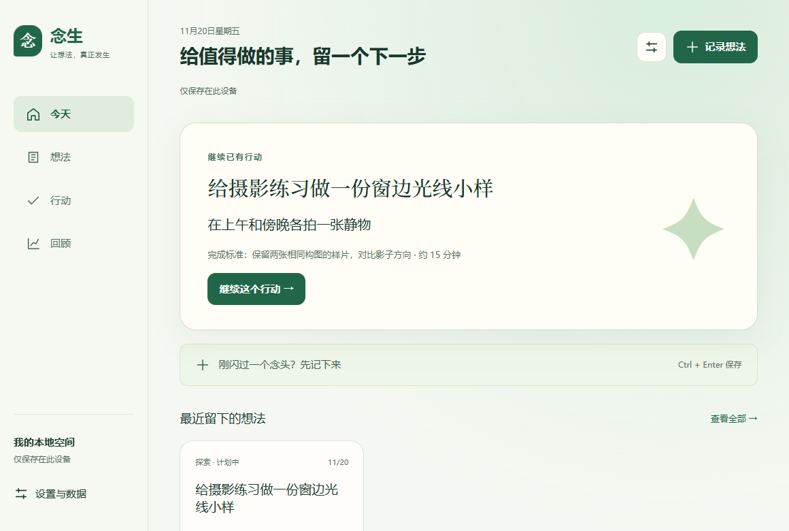
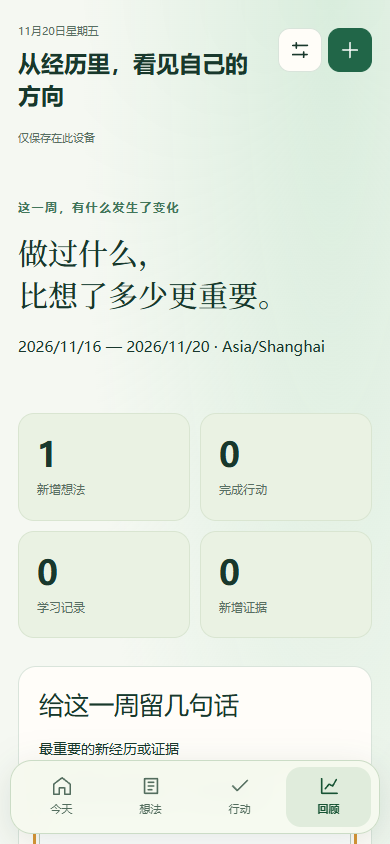

# 念生 · 产品使用说明

**让值得实现的想法，真正发生。** 从一句念头开始，整理它，做一个小行动，记下结果和学习，再决定接下来做什么。念生适合创作、学习、探索和生活目标。

[在线使用](https://nian-sheng.bobbyyang887.chatgpt.site/) · [Cloudflare 入口](https://app.nian-sheng.workers.dev/) · [免登录体验](https://robertyoung446.github.io/nian-sheng/)

| 入口 | 数据保存方式 |
| --- | --- |
| 在线版 | 游客记录留在当前浏览器。登录后，在账户空间保存的记录可以同步到其他设备。 |
| 免登录版 · GitHub Pages | 使用相同的核心界面。记录留在当前浏览器，可以通过 JSON 备份迁移。 |

## 从想法到行动

1. **今天**。点「记录想法」，写下一句念头，再点「记下来」。已有行动时，「今天」会优先展示焦点和完成标准。
2. **想法**。打开一条记录，在「原文与整理」补充标题、方向和标签。可以搜索想法、行动、结果和证据，用状态筛选待整理或已归档的记录。
3. **行动**。在想法详情的「下一步」填写「做什么」和「怎样算做完」，保存并开始。做完后，先记录实际结果，学习可以稍后补写。可以继续下一步、搁置、结束或归档整个想法。
4. **回顾**。看看这一周新增了哪些想法、完成了哪些行动，再写下发生变化的判断和接下来要做的一步。

可以在空白的「今天」页选择「先体验三个示例」。示例空间是只读的，个人记录和统计独立保存。

## 备份、恢复与迁移

1. 在「设置与数据」选择「导出完整 JSON 备份」。
2. 到目标浏览器或空间打开「设置与数据」，通过「导入备份，先预览再确认」选取 JSON。
3. 核对想法、行动、记录、历程和回顾的数量，再点「确认导入独立副本」。导入会保留已有记录。

从旧版 GitHub Pages 升级时，同一浏览器会读取原有本地记录。旧版导出的 JSON 也可以手动导入，原文修订、修改原因和当时的目标可在想法详情的「记录与历程」中查看。导入跨网址的本地记录时，先从原网址导出，再到目标网址导入。登录不会自动上传游客记录。

大型备份可以恢复到游客本地空间，实际可用容量取决于浏览器。在线账户云端单空间容量为 1.5 MB，超限会提示，已保存到本机的待同步操作仍可导出。

## 离线和同步

可通过 Windows Edge 或 Chrome 的安装菜单、Android Chrome 的「安装应用」或「添加到主屏幕」使用 PWA，具体入口由浏览器提供。先联网打开一次，让应用准备离线资源。

账户空间先保存到本机。看到「已同步到云端」后，才表示云端已确认。恢复联网后可在应用内继续同步，登录过期时重新登录即可续传。遇到同步冲突时，可以按提示保留双方版本。

## 可选 AI 和关系图谱

在在线版登录后，可在「设置与数据」配置 AI，再到想法详情的「思考伙伴」选择「帮我澄清」「给我下一步」或「挑战我的假设」。自填 Key 只在当前页面内存中使用。记录、行动和回顾无需配置 AI。

「想法」页也提供关系图谱。本地连接依据共同标签或相同方向生成，可以把有用的关联保存为结论。

[开发与接口说明](docs/development.md) · [发布验收清单](RELEASE-CHECKLIST.md)
